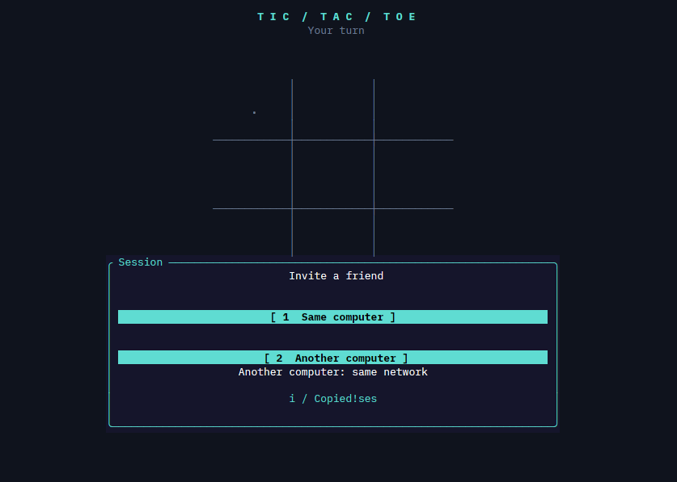
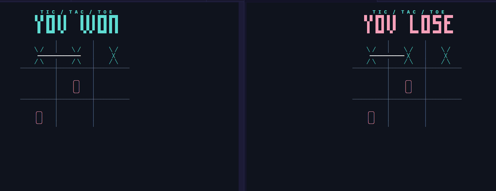
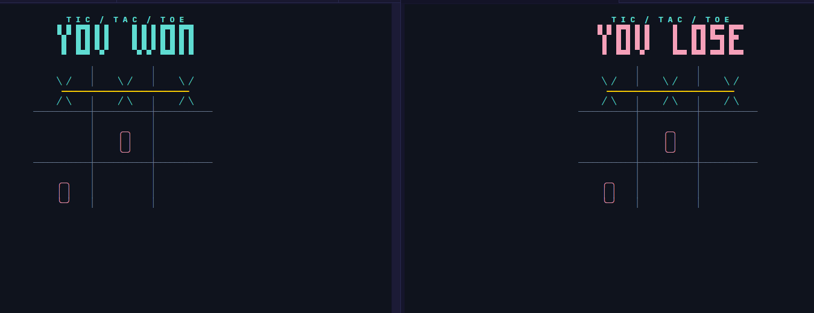

## Install

Download a release binary:

```sh
curl -fsSL https://raw.githubusercontent.com/Rabin18Glan/Tictactoe/main/install.sh | sh
```

Build from source with Cargo:

```sh
cargo install --git https://github.com/Rabin18Glan/Tictactoe.git --locked
```






